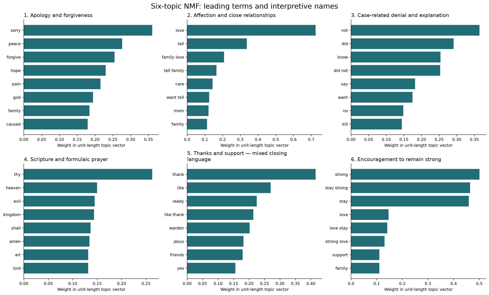
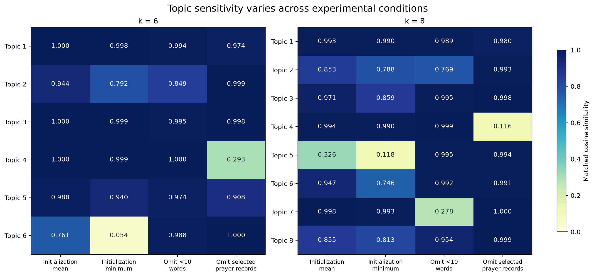

# Last Statements: Themes, Interpretation and Robustness

An exploratory NLP project analyzing published last statements from
Texas execution records.

## Research question

What recurring expressions appear in these statements, and how sensitive
are the resulting topic structures to initialization, short texts and
selected formulaic prayers?

## Analysis

Start with
[the analysis notebook](notebooks/01_last_statements_analysis.ipynb).

The supplied snapshot contains:

- 603 execution records.
- 480 person-level candidate documents.
- 479 documents prepared for exploration.
- 477 documents with retained TF-IDF features.
- 50 manually reviewed records used for coding-guideline development.

The six-topic NMF solution is the main exploratory summary, with an
eight-topic supplement. Topics concern apology and forgiveness,
affection, case-related denial and explanation, formulaic prayer,
thanks and support, and encouragement.

## Main findings

- Contraction normalization removed a tokenization-driven topic.
- Topic sensitivity differs across initialization and record-removal
  experiments.
- Lexical stability does not guarantee semantic validity: similar words
  can express denial, uncertainty or quoted denial followed by admission.

Topic coefficients are not probabilities. The project does not infer
actual guilt, sincerity, remorse or psychological state.

## Results at a glance

### Six-topic exploratory summary



### Robustness checks



## Methods

TF-IDF uses unigrams and bigrams. NMF models with 4, 6 and 8 components
were compared. Robustness checks examine five random initializations,
omission of modeled texts shorter than ten words, and omission of ten
records containing selected prayer phrases.

The removal experiments keep vocabulary and IDF fixed and remove entire
records. They do not isolate the effects of prayer passages alone. The ten
prayer records were selected using the observed component's content: this is
a targeted influence check, not independent confirmation. The prayer component
reflects repeated expression form; its substantive interpretation remains open.

The 50 reviewed records were used for guideline development and non-blind
adjudication, not independent evaluation. Manual labels were not used
to fit NMF.

## Annotation guide

The [frozen v2 annotation guide](docs/ANNOTATION_GUIDE.md) documents all eight
manual coding categories, values and interpretation boundaries. These
categories are separate from the NMF topics and describe expressed language,
not a speaker's internal psychological state.

## Reproduction

### 1. Set up a fresh working copy

Use a new folder so the snapshot does not overwrite existing local data.

```bash
git clone https://github.com/Doraaadorable/death-row-last-statements-nlp.git
cd death-row-last-statements-nlp
python3 -m venv .venv
source .venv/bin/activate
python -m pip install -r requirements.txt
```

### 2. Obtain the curated inputs

Download [data_snapshot_v1.zip](https://github.com/Doraaadorable/death-row-last-statements-nlp/releases/download/data-v1/data_snapshot_v1.zip)
from [Data snapshot v1](https://github.com/Doraaadorable/death-row-last-statements-nlp/releases/tag/data-v1)
and place it in the project root. Select the named data attachment, not
GitHub's automatically generated source-code ZIP.

Expected ZIP SHA-256:

```text
c56a4be1915cdaefd5ea1878da47d009f0cb9de8082401f7de241d42a7266168
```

On macOS, verify the downloaded bytes before extraction:

```bash
shasum -a 256 data_snapshot_v1.zip
```

After confirming the hash matches, extract into the fresh project folder:

```bash
unzip -n data_snapshot_v1.zip
```

The archive contains four curated CSV inputs under `data/processed/`,
the model-text change log, preparation metadata, a snapshot manifest
with per-file hashes, and source/use notes. Curated data remain ignored
by Git and are distributed through the Release attachment.

### 3. Read or rerun the analysis notebook

```bash
python -m notebook
```

Open `notebooks/01_last_statements_analysis.ipynb` and select
**Restart Kernel and Run All Cells**. The notebook reads the published
model outputs and verifies the model-corpus hash; it does not refit NMF.

### 4. Optional: refit the models and robustness experiments

Run these in order in a separate working copy if you want to preserve
the published result files for comparison:

```bash
python src/prepare_model_text.py
python src/run_nmf_v2.py
python src/check_nmf_stability.py
python src/check_short_text_sensitivity.py
python src/check_prayer_sensitivity.py
```

The original environment versions and parameters are recorded in
`results/nmf_v2/run_manifest.json`. The dependency list is not a lockfile.
Numerical results can vary across versions. Repaired checks use numerical
reference weights and regenerated full matrices rather than keyword ordering.
They save diagnostics in new v2 directories, preserving historical outputs.
See [the follow-up report](docs/FOLLOWUP_AUDIT.md) for tolerances and provenance.

This snapshot supports downstream reproduction from curated inputs.
Raw HTML, upstream extraction tables and every manual review decision
are not included, so it is not a complete reconstruction of source
collection and extraction. The index dates describe the supplied
snapshot, not the archive's packaging date.

## Source and assistance

Source: [Texas Department of Criminal Justice, Executed Inmates](
https://www.tdcj.texas.gov/death_row/executed_inmates.html).

The supplied index snapshot spans December 7, 1982 to October 7, 2026.
Statement-level source links are retained in the corpus.

AI assisted with code, documentation and interpretation discussions.
The project owner reviewed and approved the v2 coding decisions.
This does not constitute independent expert validation.

## Follow-up audit

Read [the follow-up notebook](notebooks/02_followup_audit.ipynb),
[the dated protocol](docs/MODEL_SELECTION_PROTOCOL.md) and
[the execution report](docs/FOLLOWUP_AUDIT.md).

The follow-up retains all 3,196 features, saves complete regenerated numerical
references, and separates random-seed pairwise comparisons from comparisons
with the NNDSVDa reference. No unique winning k is established. Reference
reconstruction captures approximately 7.3%, 8.7% and 10.0% of squared TF-IDF
Frobenius norm at k=4/6/8; this is neither semantic coverage nor regression R².

Frozen-label contrasts report n and quartiles for 0/1/u separately and are
strictly descriptive. The [current inclusion ledger](reports/inclusion_ledger_v2.csv)
records 480 included and 123 excluded records: 102 shared-notice links,
13 reports of no statement, four ambiguous short responses, and four summaries
or references. The [21-record evidence extract](reports/inclusion_evidence_21_v1.csv)
documents previously missing historical exclusion reasons. This establishes
current-version inclusion history, not that every exclusion is substantively
settled: speaker attribution remains unresolved for executions 463, 533, 539
and 567; execution 241 contains an explicit supplied translation and is flagged
for reconsideration in a future corpus version. Frozen data and models are unchanged.
Zero-feature execution IDs are 83 and 238.

To regenerate only the new follow-up tables after obtaining the data snapshot:

```bash
python src/run_followup_audit.py
python src/build_inclusion_ledger.py
```

`build_inclusion_ledger.py` regenerates the historical v1 ledger from the Release
snapshot; it does not regenerate the evidence-enriched v2 ledger. The latter
was built in [the inclusion-review notebook](notebooks/03_inclusion_review.ipynb)
using the owner's upstream cleaning table. That full table is not in the
Release; its SHA-256 is recorded in the committed evidence extract.

The supplementary notebook reads these tables. Its owner-executed outputs were
committed in `5bfe829`: three code cells numbered 1 through 3, four saved display
outputs and no stored error outputs. This verifies result loading and display,
not a new model fit or independent execution. Historical result directories
and frozen labels remain unchanged.
